<div align="center">


# FitVerse

[](https://developer.android.com) [](https://flutter.dev) [](https://github.com/mina-android/FitVerse/releases) [](LICENSE)

<p align="center">
  A mobile fitness coaching and workout tracking platform combining hardware biometric telemetry, real-time accelerometer motion coaching, and Gemini-assisted training analysis.
</p>

</div>

---

## Navigation

[Features](#features) &bull; [Screenshots](#screenshots) &bull; [Downloads](#downloads) &bull; [Self Building & Local Setup](#self-building--local-setup) &bull; [Contribution](#contribution) &bull; [About the Developer](#about-the-developer) &bull; [Donate](#donate) &bull; [License](#license)

---

## Features

### Core Capabilities

- **Exercise Library & Routine Planning**: Over 90 structured exercises categorized by targeted muscle anatomy, equipment requirements, and movement biomechanics with custom workout builder routines.
- **Motion Sensor Repetition Tracking**: Real-time rep counting and cadence tracking utilizing device accelerometer sensors when wearable hardware is unavailable.
- **Biometric Health Connect Integration**: Native Android Health Connect synchronization collecting steps, resting heart rate, active calorie expenditure, and sleep phase telemetry.
- **Contextual Gemini AI Coach**: Integrates user training volume, recovery metrics, and recorded fatigue indicators directly into Gemini API prompts to produce personalized training adjustments.
- **Rest & Interval Timers**: Background audio-signaled interval timers providing countdown chimes and set-break pacing.

### Architecture & Data Handling

- **Local-First with Cloud Sync**: Interfaces render directly against local on-device SQLite caches to ensure instant UI responsiveness, subsequently synchronizing state to Cloud Firestore when network connectivity is established.
- **Authentication**: Optional Google Firebase Authentication supporting credentialed multi-device session portability.
- **Data Privacy**: Biometric measurements remain on the device and are passed to AI services only within ephemeral session requests when analysis is explicitly requested.

---

## Screenshots

<table width="100%" border="0" cellspacing="0" cellpadding="4">
  <tr>
    <td width="33.33%" align="center" valign="top">
      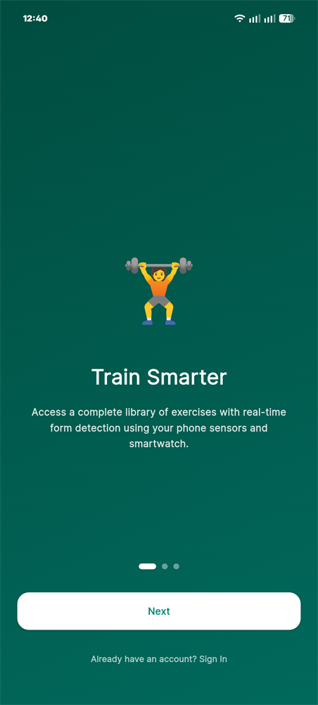
    </td>
    <td width="33.33%" align="center" valign="top">
      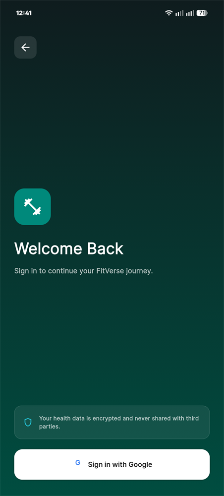
    </td>
    <td width="33.33%" align="center" valign="top">
      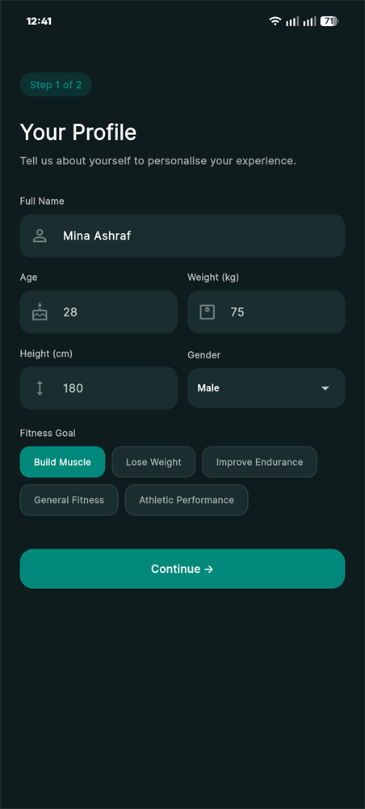
    </td>
  </tr>
  <tr>
    <td width="33.33%" align="center" valign="top">
      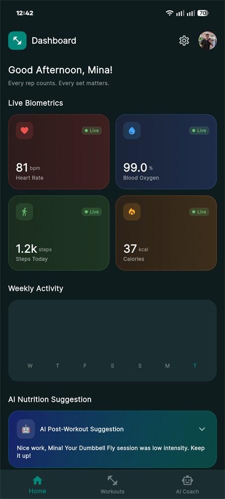
    </td>
    <td width="33.33%" align="center" valign="top">
      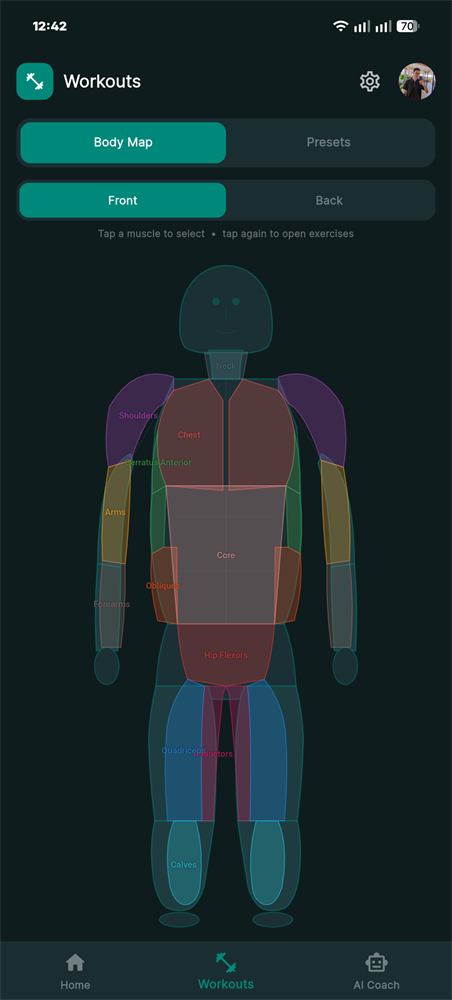
    </td>
    <td width="33.33%" align="center" valign="top">
      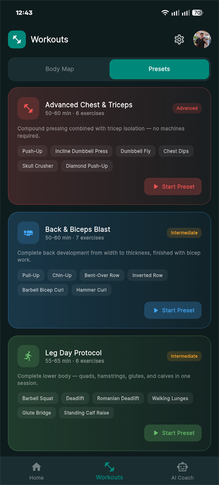
    </td>
  </tr>
  <tr>
    <td width="33.33%" align="center" valign="top">
      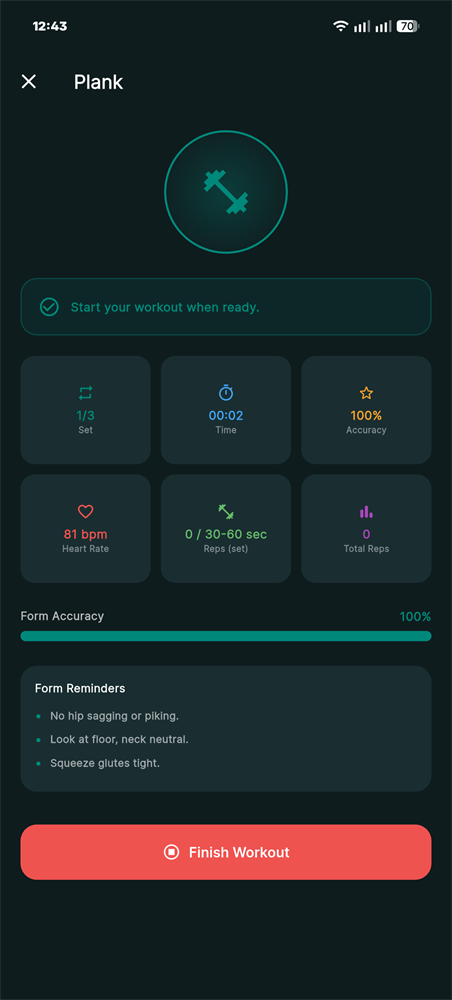
    </td>
    <td width="33.33%" align="center" valign="top">
      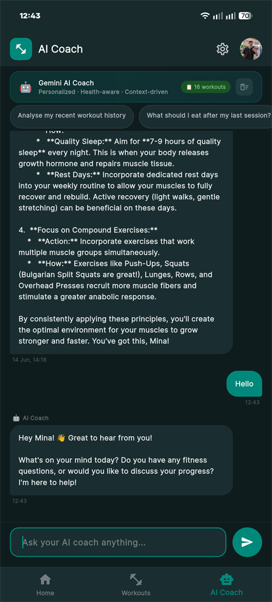
    </td>
    <td width="33.33%" align="center" valign="top">
      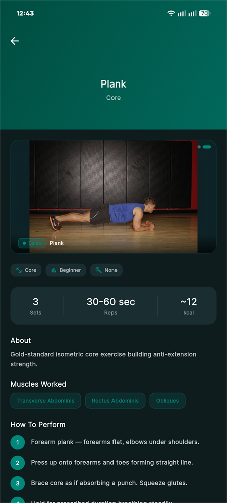
    </td>
  </tr>
  <tr>
    <td width="33.33%" align="center" valign="top">
      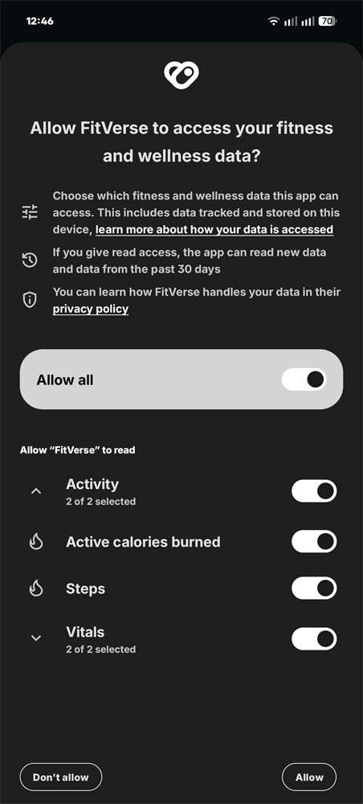
    </td>
    <td width="33.33%" align="center" valign="top">
      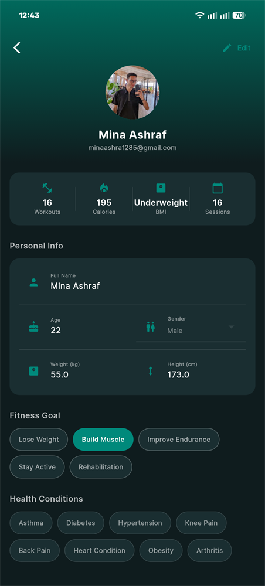
    </td>
    <td width="33.33%" align="center" valign="top">
      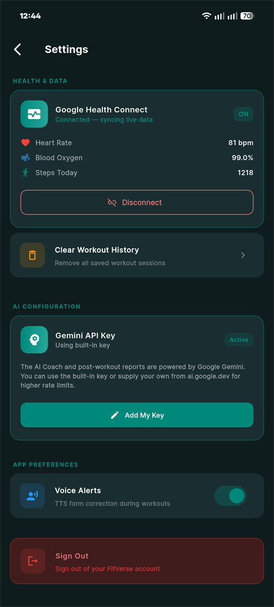
    </td>
  </tr>
</table>

---

## Downloads

Official release packages are published under the [GitHub Releases](https://github.com/mina-android/fitverse/releases) section.

| Platform | Architecture | Package Type | Download Link | Notes |
| :--- | :--- | :--- | :--- | :--- |
| **Android** | arm64-v8a | `.apk` | [Download (v1.0.0)](https://github.com/mina-android/fitverse/releases/latest) | Standard 64-bit Android builds (recommended) |
| **Android** | armeabi-v7a | `.apk` | [Download (v1.0.0)](https://github.com/mina-android/fitverse/releases/latest) | Legacy 32-bit hardware |
| **Android** | x86_64 | `.apk` | [Download (v1.0.0)](https://github.com/mina-android/fitverse/releases/latest) | Android desktop emulators |
| **Android** | Universal | `.apk` | [Download (v1.0.0)](https://github.com/mina-android/fitverse/releases/latest) | Multi-architecture APK installer |

---

## Self Building & Local Setup

### 1. Prerequisites

Verify that the following development toolchains are installed:

- **Flutter SDK**: `3.19.0` or higher
- **Dart SDK**: `3.3.0` or higher
- **Android SDK**: API level `34` (Android 14)
- **Java Development Kit**: JDK `17`
- **Firebase CLI**: Configured if deploying custom backend instances

### 2. Repository Setup

```bash
# Clone the repository
git clone https://github.com/mina-android/fitverse.git

# Navigate into the project root
cd fitverse

# Verify Flutter tooling
flutter doctor
```

### 3. Backend & API Configuration

1. **Firebase**: Create a project in the Firebase Console, enable Firestore and Authentication, and execute:
   ```bash
   flutterfire configure
   ```
2. **Gemini API Key**: Obtain a key from Google AI Studio and configure it in your local environment file or build config:
   ```bash
   export GEMINI_API_KEY="your-api-key"
   ```

### 4. Dependency Installation & Build

```bash
# Install dependencies
flutter pub get

# Compile release APK
flutter build apk --split-per-abi --release
```

Compiled binaries will be placed in `build/app/outputs/flutter-apk/`.

### 5. Running Locally

```bash
flutter run --release
```

---

## Contribution

Contributions focusing on exercise database expansion, sensor calibration, and UI improvements are welcome.

### Contribution Process

1. Review existing issues to prevent redundant feature requests.
2. For large architectural changes or new sensor pipelines, open a discussion ticket prior to submitting code.
3. Verify test integrity before opening pull requests:
   ```bash
   flutter analyze
   flutter test
   ```
4. Submit your pull request against `main`.

---

## About the Developer

This project is authored and maintained by **mina-android**, focused on developing transparent, local-first utilities and privacy-conscious software.

[](https://portfolio.minaashraf285.workers.dev/) [](https://github.com/mina-android) [](https://github.com/mina-android/FitVerse/issues)

---

## Donate

Development and maintenance of this software are independent and self-supported. If this project helps you in your workflow, consider supporting development:

[](https://paypal.me/minaashraf285) [](https://github.com/sponsors/mina-android) [](https://ko-fi.com/minaashraf285)

---

## License

Distributed under the **GNU General Public License v3.0 (GPL-3.0)**. See the [`LICENSE`](LICENSE) file in the root directory for legal text.

```text
Copyright (c) 2026 mina-android
Licensed under the GNU General Public License v3.0.
```
